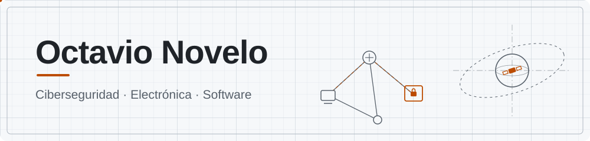

<div align="center">



<a href="https://github.com/OctavioNovelo">
  
</a>

<br/>


</div>

---

## 🖥️ `~/OctavioNovelo` — Sobre mí

Me interesa la ciberseguridad y construir cosas que funcionen en el mundo real, tanto en software como en hardware. Si quieres platicar de seguridad, electrónica o robótica, escríbeme.

```bash
octavio@192.168.4.1:~$ cat perfil.txt

  Nombre     : Octavio Novelo
  Enfoque    : Ciberseguridad
  También    : Electrónica, sistemas embebidos y desarrollo
  Aprendiendo: JavaScript + seguridad ofensiva
  Misión     : Automatizar lo repetitivo y entender lo complejo
  Estado     : Construyendo HERA · CanSat 2027 · Robert 2027 · Robot Raton

octavio@192.168.4.1:~$ _
```

---

## 🚀 Proyectos

<table>
  <tr>
    <td width="50%" valign="top">
      <h3>🛡️ HERA</h3>
      <b>Herramientas Ejecutables de Reconocimiento y Auditoría</b><br/><br/>
      Automatiza la fase de reconocimiento y auditoría de seguridad.<br/><br/>
      <a href="https://github.com/OctavioNovelo/Herramientas-Ejecutables-de-Reconocimineto-y-Auditoria"></a>
      <!-- Agrega aquí una captura o GIF de HERA funcionando -->
    </td>
    <td width="50%" valign="top">
      <h3>🛰️ CanSat 2027</h3>
      <b>Hardware + telemetría</b><br/><br/>
      Un satélite del tamaño de una lata, programado y construido desde cero.<br/><br/>
      
      
      <!-- Agrega aquí una foto de tu CanSat -->
    </td>
  </tr>
  <tr>
    <td width="50%" valign="top">
      <h3>🤖 Robert 2027</h3>
      <b>Robótica / competencia</b><br/><br/>
      Proyecto en desarrollo para 2027.<br/><br/>
      
      
    </td>
    <td width="50%" valign="top">
      <h3>🖱️ UMouse</h3>
      <b>Robot Raton</b><br/><br/>
      Robot en desarrollo.<br/><br/>
      
      
    </td>
  </tr>
</table>

<div align="center">

[](https://github.com/OctavioNovelo?tab=repositories)

</div>

---

## 🧰 Arsenal

<div align="center">

<table>
  <tr>
    <td><b>Lenguajes</b></td>
    <td>
      <picture>
        <source media="(prefers-color-scheme: dark)" srcset="https://skillicons.dev/icons?i=py,js,cpp,cs,bash,html,css&perline=10&theme=dark">
        
      </picture>
    </td>
  </tr>
  <tr>
    <td><b>Hardware y embebidos</b></td>
    <td>
      <picture>
        <source media="(prefers-color-scheme: dark)" srcset="https://skillicons.dev/icons?i=arduino,platformio&perline=10&theme=dark">
        
      </picture>
    </td>
  </tr>
  <tr>
    <td><b>Motores y 3D</b></td>
    <td>
      <picture>
        <source media="(prefers-color-scheme: dark)" srcset="https://skillicons.dev/icons?i=unity,blender&perline=10&theme=dark">
        
      </picture>
    </td>
  </tr>
  <tr>
    <td><b>Sistema y control de versiones</b></td>
    <td>
      <picture>
        <source media="(prefers-color-scheme: dark)" srcset="https://skillicons.dev/icons?i=linux,git,docker&perline=10&theme=dark">
        
      </picture>
    </td>
  </tr>
</table>

</div>

---

## 📊 Stats

<div align="center">

<picture>
  <source media="(prefers-color-scheme: dark)" srcset="https://github-readme-stats.vercel.app/api?username=OctavioNovelo&show_icons=true&hide_border=true&theme=transparent&title_color=f0883e&icon_color=f0883e&text_color=c9d1d9&locale=es">
  
</picture>
<picture>
  <source media="(prefers-color-scheme: dark)" srcset="https://github-readme-stats.vercel.app/api/top-langs/?username=OctavioNovelo&layout=compact&hide_border=true&theme=transparent&title_color=f0883e&text_color=c9d1d9&locale=es">
  
</picture>

</div>

---

## 🤝 Contacto

<div align="center">

[](mailto:octavionovelo22@proton.me)
[](https://github.com/OctavioNovelo)

<sub>Todo lo que hago en seguridad es con fines educativos y de auditoría autorizada.</sub>

</div>