<div align="center">


<a href="https://github.com/OctavioNovelo">
  
</a>

<br/>


</div>

---

## 🖥️ `~/OctavioNovelo` — Sobre mí

```bash
octavio@192.168.4.1:~$ cat perfil.txt

  Nombre     : Octavio Novelo
  Enfoque    : Ciberseguridad
  También    : Electrónica, sistemas embebidos y desarrollo
  Aprendiendo: JavaScript + seguridad ofensiva
  Misión     : Automatizar lo repetitivo y entender lo complejo
  Estado     : Construyendo HERA · CanSat 2027 · Robert 2027 · Robot Raton

octavio@192.168.4.1:~$ _
```

---

## 🚀 Proyectos

<table>
  <tr>
    <td width="50%" valign="top">
      <h3>🛡️ HERA</h3>
      <b>Herramientas Ejecutables de Reconocimiento y Auditoría</b><br/><br/>
      Automatización de la fase de reconocimiento y auditoría de seguridad.<br/><br/>
      <a href="https://github.com/OctavioNovelo/Herramientas-Ejecutables-de-Reconocimineto-y-Auditoria"></a>
    </td>
    <td width="50%" valign="top">
      <h3>🛰️ CanSat 2027</h3>
      <b>Hardware + telemetría</b><br/><br/>
      Un satélite del tamaño de una lata, programado y construido desde cero.<br/><br/>
      
      
    </td>
  </tr>
  <tr>
    <td width="50%" valign="top">
      <h3>🤖 Robert 2027</h3>
      <b>Robótica / competencia</b><br/><br/>
      Proyecto en desarrollo para 2027.<br/><br/>
      
      
    </td>
    <td width="50%" valign="top">
      <h3>🖱️ UMouse</h3>
      <b>Robot Raton</b><br/><br/>
      En desarrollo.<br/><br/>
      
      
    </td>
  </tr>
</table>

<div align="center">

[](https://github.com/OctavioNovelo?tab=repositories)

</div>

---

## 🧰 Arsenal

<div align="center">


</div>

---

## 📊 Stats

<div align="center">


<br/>


<br/>

</div>

---

## 🤝 Contacto

<div align="center">

[](mailto:octavionovelo22@proton.me)
[](https://github.com/OctavioNovelo)

</div>

> ⚖️ Todo lo que hago en seguridad es con fines **educativos y de auditoría autorizada**. Hackea con ética.

<div align="center">

</div>
